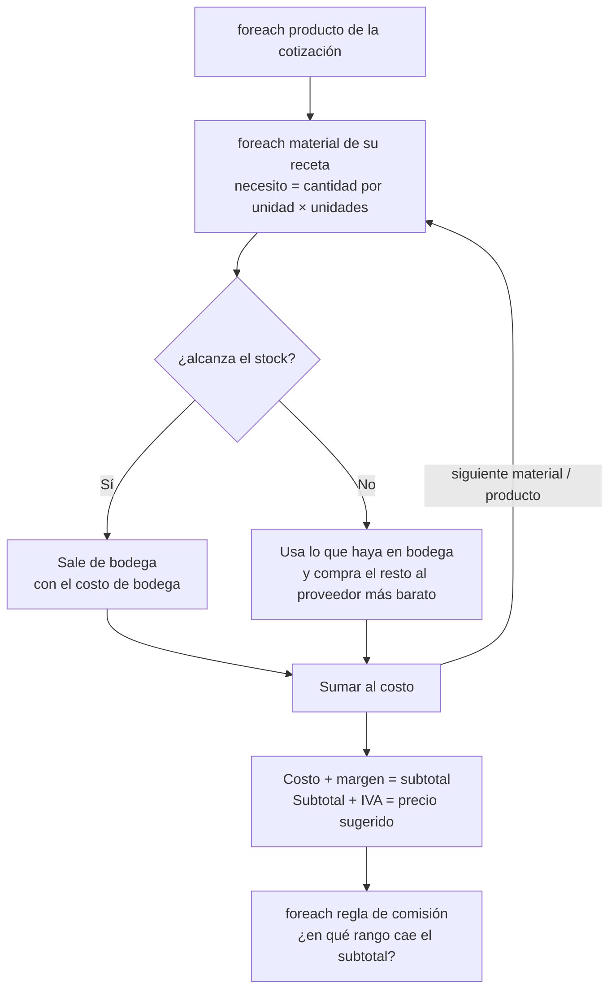
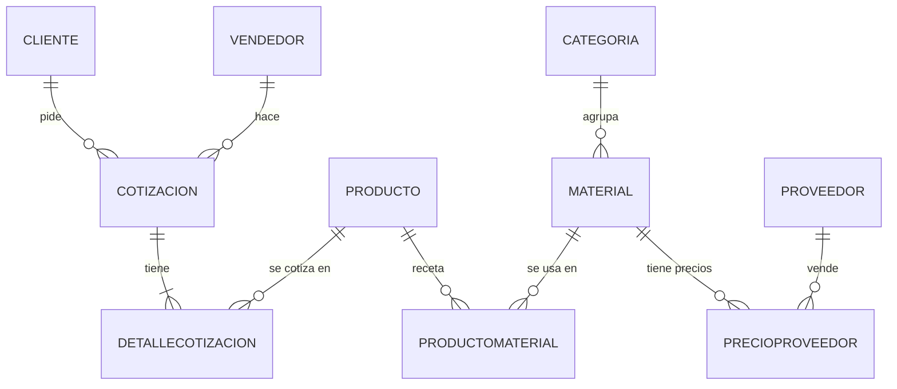

# INSECOM Cotizador — ASP.NET Core MVC

Proyecto de la materia **Ingeniería Web (ISWZ3101)** de la UDLA: sistema de cotizaciones para **INSECOM S.A.** (Quito), empresa que fabrica tableros eléctricos y envolventes metálicos NEMA.

Hoy, cotizar un tablero implica revisar a mano qué materiales lleva, cuánto hay en bodega y cuánto cobra cada proveedor. Este sistema lo hace solo: a partir de la **receta** de cada producto, el **inventario** y los **precios de los proveedores**, calcula el **precio sugerido**, el **plazo de entrega** y la **comisión del vendedor**.

| | |
|---|---|
| **Demo en línea** | https://insecomcotizador.onrender.com (plan gratis de Render: la primera carga tarda ~1 min si estaba dormida, y los datos se borran al reiniciar) |
| **Video Tarea 8 (administración)** | https://www.youtube.com/watch?v=4zDrhHZbS2I |

## Contenido

1. [El core: cálculo de la cotización](#1-el-core-cálculo-de-la-cotización-progreso-2)
2. [Cómo probar el core paso a paso](#2-cómo-probar-el-core-paso-a-paso)
3. [Administración (lo que alimenta el core)](#3-administración-lo-que-alimenta-el-core)
4. [Modelo de datos](#4-modelo-de-datos)
5. [Dónde está cada cosa en el código](#5-dónde-está-cada-cosa-en-el-código)
6. [Ejecutar en local y desplegar](#6-ejecutar-en-local-y-desplegar)

---

## 1. El core: cálculo de la cotización (Progreso 2)

Está en **`Controllers/CotizacionesController.cs`**, método **`Calcular`**, escrito con `foreach` e `if` explícitos. Cruza **11 tablas**: Cotizacion, DetalleCotizacion, Cliente, Vendedor, Producto, ProductoMaterial, Material, PrecioProveedor, Proveedor, Configuracion y ReglaComision.



**Reglas del cálculo**

1. **Por cada producto** de la cotización → **por cada material de su receta** se calcula cuánto hace falta.
2. **Si alcanza el stock** de bodega, se usa con el costo de bodega. **Si no**, se usa lo que haya y el resto se compra al **proveedor más barato** de ese material.
3. El **plazo de entrega** es el mayor tiempo de entrega de lo que hay que comprar (si todo sale de bodega, es inmediato).
4. Si dos productos usan el mismo material, el stock se va descontando mientras se recorre, para no contarlo dos veces (diccionario `disponible`).
5. **Costo + margen = subtotal** y **subtotal + IVA = precio sugerido**. El margen y el IVA se configuran en *Parámetros → Margen e IVA*.
6. **Comisión:** se busca en qué rango de las reglas de comisión cae el subtotal y se aplica ese porcentaje.
7. **Al aprobar**, se vuelve a calcular, se **descuenta el stock** de bodega y se guardan el precio de cada producto, el total, el plazo y la comisión. Una cotización aprobada ya no se puede editar ni borrar.
8. Si falta un material y ningún proveedor lo vende, o un producto no tiene receta, la cotización **no se puede aprobar** y la pantalla dice qué falta.

**Ejemplo real (con los datos de la demo):** 13 tableros de distribución necesitan 13 breakers 3P 32 A. En bodega hay 12 → se usan los 12 a $48,50 y se compra 1 a Distribuidora Eléctrica Quito a $49,90 (más barato que Schneider a $52,00), con un plazo de 3 días. Al aprobar, el stock de ese breaker queda en 0.

## 2. Cómo probar el core paso a paso

1. Entrar con el usuario administrador.
2. **Cotizaciones → Nueva cotización**: elegir cliente y vendedor.
3. Agregar productos con su cantidad. La pantalla muestra, por cada material, cuánto sale de bodega, cuánto se compra, a qué proveedor y a qué precio, y a la derecha el resumen (costo, margen, IVA, precio sugerido, plazo y comisión).
4. **Probar que el admin impacta en el core:** ir a *Producción → Materiales*, bajar el stock de un material y volver a la cotización → ahora ese material se compra al proveedor. Lo mismo pasa al cambiar un precio de proveedor, el margen o las reglas de comisión.
5. **Aprobar**: se descuenta el stock (se ve en Materiales) y la comisión aparece en *Vendedores → Comisión ganada*.

## 3. Administración (lo que alimenta el core)

Todo lo que usa el cálculo se registra desde la aplicación; nada se carga a mano en la base de datos.

| Módulo | Qué se puede hacer |
|---|---|
| Login | Inicio y cierre de sesión con cookie; contraseña cifrada (PBKDF2). Todas las páginas piden sesión. |
| Clientes | CRUD con buscador. **El RUC se valida en el back-end** antes de grabar. |
| Vendedores | CRUD, con el número de cotizaciones aprobadas y la comisión ganada. |
| Productos y recetas | CRUD de productos y su receta (qué materiales lleva una unidad). El material se elige con **dropdowns en cascada** (categoría → materiales). |
| Categorías de materiales | CRUD (Breakers, Láminas, Cables…). |
| Materiales (inventario) | CRUD con categoría, stock y costo en bodega; precios y días de entrega de cada proveedor. |
| Proveedores | CRUD. |
| Reglas de comisión | CRUD de rangos; valida que el máximo sea mayor que el mínimo y que los rangos no se crucen. |
| Margen e IVA | Parámetros de la fórmula del precio. |

**Validación en el back-end (dato sensible: RUC).** Se valida en el controlador (`ClientesController.ValidarRuc`) aunque alguien se salte el HTML o el JavaScript: 13 dígitos; provincia válida (01–24 o 30); tercer dígito válido; no termina en `000`; para persona natural, dígito verificador de la cédula (módulo 10); y no se repite con otro cliente. También se valida en el back que existan de verdad el cliente, el vendedor, el producto, la categoría y el material que llegan desde los formularios.

**Dropdowns en cascada.** Ninguna clave foránea se escribe a mano. En la receta se elige la categoría y, con `fetch`, se pide al controlador (`ProductosController.MaterialesPorCategoria`, devuelve JSON) la lista de materiales de esa categoría.

**Integridad de datos.** No se puede borrar un material que está en una receta, un proveedor con precios, ni un cliente o vendedor con cotizaciones. Al borrar un producto se borra su receta, y al borrar un material, sus precios.

## 4. Modelo de datos



Tablas sueltas que usa el cálculo: **Configuracion** (margen e IVA, una sola fila) y **ReglaComision** (rangos de monto y porcentaje). **Usuario** guarda el acceso al sistema.

## 5. Dónde está cada cosa en el código

| Carpeta / archivo | Qué contiene |
|---|---|
| `Controllers/CotizacionesController.cs` | **El core**: crear cotización, agregar productos, `Calcular`, aprobar y rechazar. |
| `Models/` | Las tablas como clases de C#. `ResultadoCotizacion.cs` no es tabla: guarda el resultado del cálculo para mostrarlo. |
| `Data/AppDbContext.cs` | Lista de tablas y sus relaciones (qué se borra en cascada y qué no). |
| `Views/Cotizaciones/` | Pantallas del core (lista, nueva cotización, detalle con el desglose). |
| `Controllers/` y `Views/` (resto) | Los CRUD de la administración. |
| `Program.cs` | Arranque: base de datos, login con cookie, usuario inicial y configuración por defecto. |
| `wwwroot/css/site.css` | Estilos con los colores de INSECOM. |

## 6. Ejecutar en local y desplegar

**Local** (requiere [.NET SDK 10](https://dotnet.microsoft.com/download)):

```bash
dotnet run
```

La base SQLite (`insecom.db`) se crea sola. El usuario inicial está en `appsettings.json` (sección `AdminInicial`). Si se cambian las tablas, se borra `insecom.db` y se vuelve a crear al arrancar.

**Render:** el proyecto tiene `Dockerfile`. En Render: *New → Web Service → Docker*, conectado a este repositorio. La app lee el puerto de la variable `PORT`. Para no usar la contraseña de ejemplo, definir las variables `AdminInicial__NombreUsuario` y `AdminInicial__Contrasena`.

**Tecnologías:** ASP.NET Core MVC (.NET 10) · Entity Framework Core · SQLite · Bootstrap 5 · Bootstrap Icons · Docker · Render

## Autor

**Jean Carlos G.** — Ingeniería de Software, UDLA.
